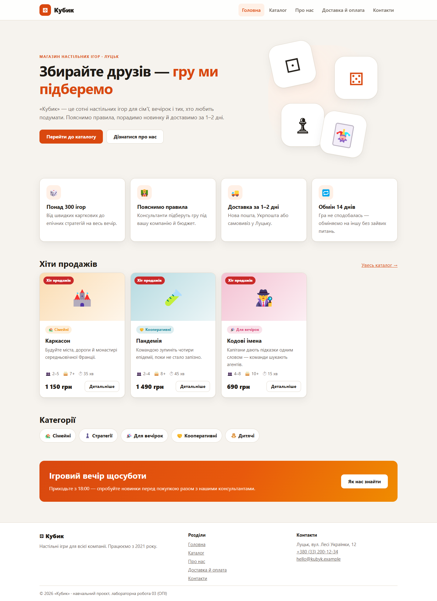

# «Кубик» — сайт магазину настільних ігор (лабораторна робота 03, ОПІ)

Багатосторінковий вебзастосунок на **Flask + Jinja2** з адаптивною версткою.
Виконано одноосібно. Звіт: [lab-reports/lab03-report-istdjfgh.md](lab-reports/lab03-report-istdjfgh.md).



## Сторінки

| Адреса | Сторінка |
|--------|----------|
| `/` | Головна |
| `/catalog` | Каталог ігор за категоріями |
| `/catalog/<slug>` | Сторінка гри (параметр в адресі) |
| `/about` | Про нас |
| `/delivery` | Доставка й оплата |
| `/contacts` | Контакти |

## Запуск

```bash
python -m venv .venv
.venv\Scripts\activate          # macOS / Linux: source .venv/bin/activate
pip install -r requirements.txt
python app.py                   # http://127.0.0.1:5000
```

## Тести

```bash
pip install -r requirements-dev.txt
python -m pytest                # 20 тестів
python scripts/make_screenshots.py   # оновити скриншоти для звіту
```

## Структура

```
app.py                 # маршрути, фільтр price, контекст-процесор, 404
data.py                # контент предметної області
templates/
  base.html            # базовий шаблон: шапка, меню, футер
  _macros.html         # макроси game_card, page_header
  home.html  catalog.html  game.html  about.html  delivery.html  contacts.html  404.html
static/css/style.css   # адаптивні стилі, світла/темна тема
tests/test_pages.py    # pytest
lab-reports/           # звіт і скриншоти
```
