# Звіт з лабораторної роботи 03. Розробка базового вебпроєкту

| | |
|---|---|
| **ПІБ** | Пламетюк Ілля |
| **Група** | ІПЗ |
| **GitHub** | [istdjfgh](https://github.com/istdjfgh) |
| **Склад команди** | роботу виконано **одноосібно** — усі ролі (розробка, верстка, тестування, звіт) виконав автор |
| **Предметна область** | інтернет-магазин настільних ігор «Кубик» (м. Луцьк) |
| **Виконані рівні** | Рівень 1 і Рівень 2 |

## 1. Особистий внесок

Оскільки робота виконана одноосібно, увесь код і всі коміти в репозиторії зроблені автором:

| Що зроблено | Файли |
|-------------|-------|
| Структура Flask-застосунку, маршрути, фільтр `price`, контекст-процесор, обробник 404 | `app.py` |
| Контент предметної області (ігри, категорії, доставка, FAQ) | `data.py` |
| Базовий шаблон з меню, футером і мобільним «бургером» | `templates/base.html` |
| Макроси `game_card` і `page_header` | `templates/_macros.html` |
| Сторінки: Головна, Каталог, Сторінка гри, Про нас, Доставка й оплата, Контакти, 404 | `templates/*.html` |
| Адаптивна верстка, світла й темна теми | `static/css/style.css` |
| 20 автотестів (pytest) і скрипт скриншотів (Playwright) | `tests/`, `scripts/` |

Коміти: [історія комітів](https://github.com/istdjfgh/opi-lab03-flask-site/commits/main).

## 2. Що реалізовано

### Рівень 1 — сторінки «Головна» і «Про нас»
- **Головна** (`/`): привітальний блок, переваги магазину, хіти продажів (цикл по іграм з `bestseller = True`), категорії, банер ігрового вечора.
- **Про нас** (`/about`): історія магазину (кількість років рахується автоматично від року заснування), статистика, цінності, кроки роботи з клієнтом.

### Рівень 2 — додаткові сторінки, меню, адаптивність
- **Каталог** (`/catalog`) — ігри згруповані за категоріями, відсортовані за ціною (фільтр `sort`), якорі-переходи до категорій.
- **Сторінка гри** (`/catalog/<slug>`) — маршрут з параметром адреси; для неіснуючої гри повертається 404. Є «хлібні крихти» і блок «Схожі ігри».
- **Доставка й оплата** (`/delivery`) — способи доставки, оплати, FAQ на `<details>`.
- **Контакти** (`/contacts`) — контакти, таблиця годин роботи, схема проїзду.
- **Сторінка 404** у стилі сайту.
- **Меню** будується циклом зі списку `NAV_ITEMS` у `app.py`; активний пункт підсвічується (`aria-current="page"`), а на сторінці гри підсвічується «Каталог».
- **Адаптивність**: CSS Grid і Flexbox, `clamp()` для розмірів шрифтів, медіазапити на 960 / 800 / 480 px. На телефоні меню ховається в «бургер» — без JavaScript, на CSS-прапорці.
- **Доступність**: семантичні теги, посилання «Перейти до вмісту», видимий фокус, `aria-label`, повага до `prefers-reduced-motion`; темна тема за налаштуваннями системи.

### Використані можливості Flask і Jinja2
| Можливість | Де використано |
|------------|----------------|
| `@app.route`, параметр `<slug>` | `app.py` |
| `render_template` | усі маршрути |
| `url_for` замість ручних адрес | меню, посилання, статичні файли |
| Наслідування (`extends`, `block`) | усі сторінки наслідують `base.html` |
| Макроси (`macro`, `import ... with context`) | `_macros.html` → картки ігор, заголовки сторінок |
| Цикли, умови, `loop.first` | меню, каталог, FAQ |
| Фільтри: власний `price`, `sort`, `length`, `lower`, `capitalize` | каталог, сторінка гри, доставка |
| `@app.context_processor` | спільні дані магазину й меню для всіх шаблонів |
| `@app.errorhandler(404)` і `abort(404)` | неіснуючі сторінки та ігри |

## 3. Скриншоти

### Звичайний (desktop) вигляд

| Сторінка | Скриншот |
|----------|----------|
| Головна | 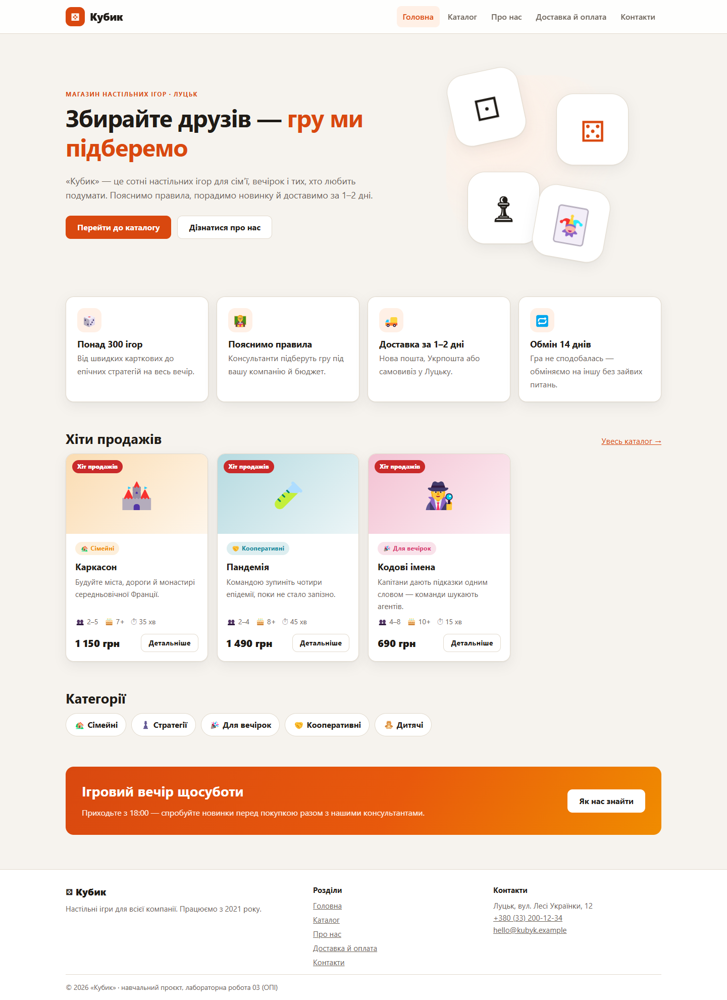 |
| Каталог | 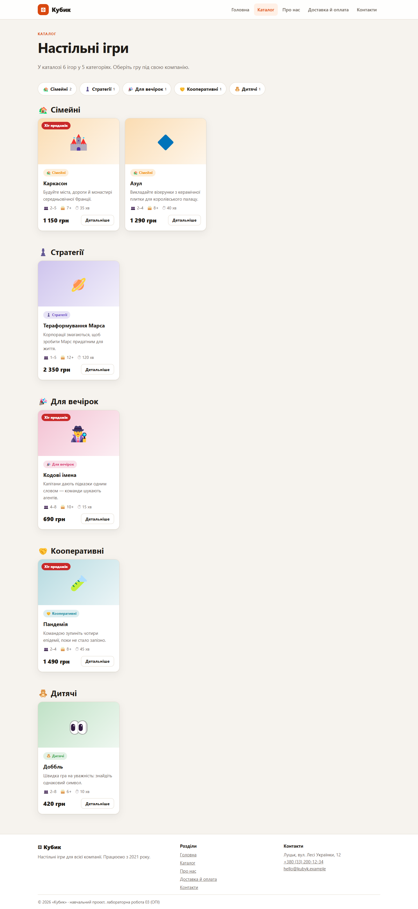 |
| Сторінка гри | 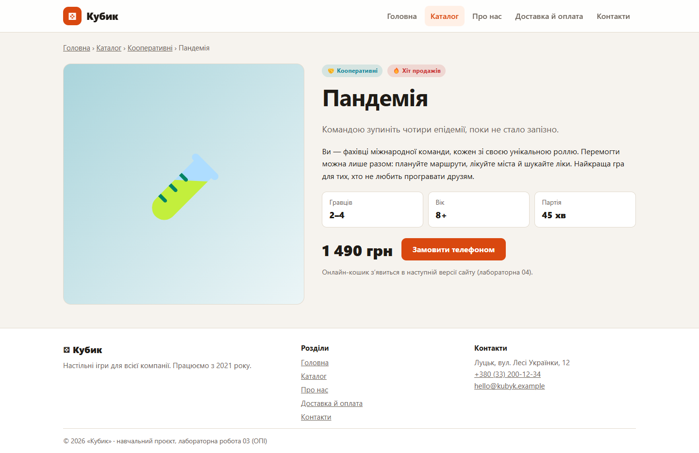 |
| Про нас | 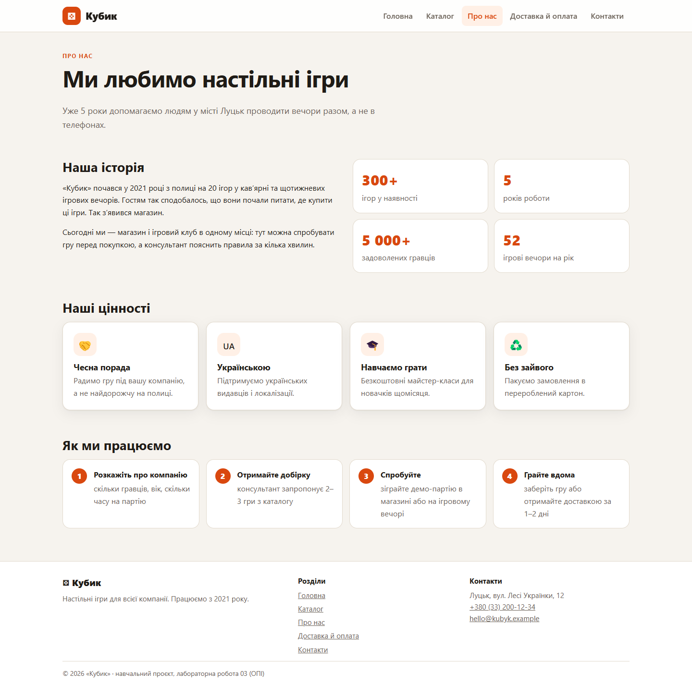 |
| Доставка й оплата | 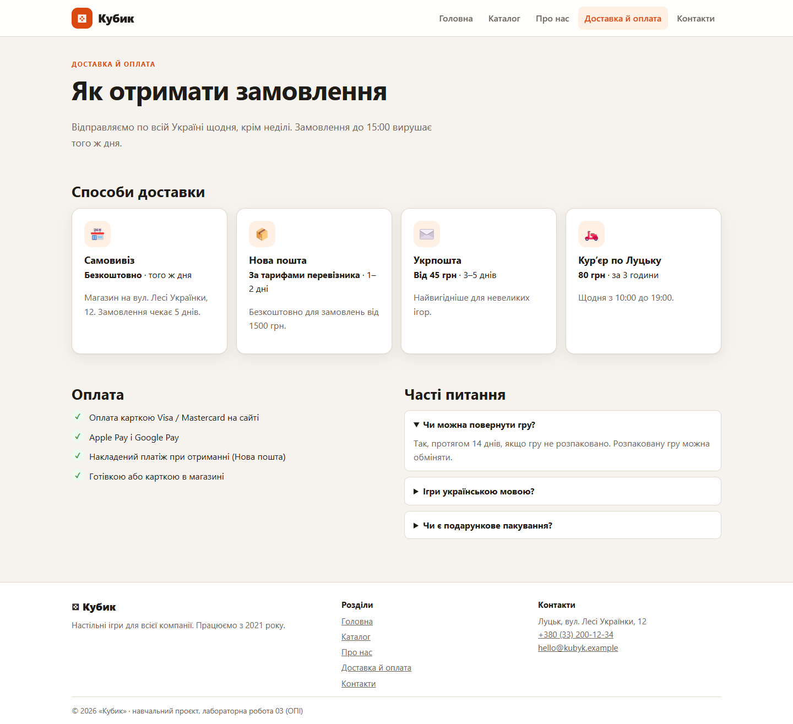 |
| Контакти | 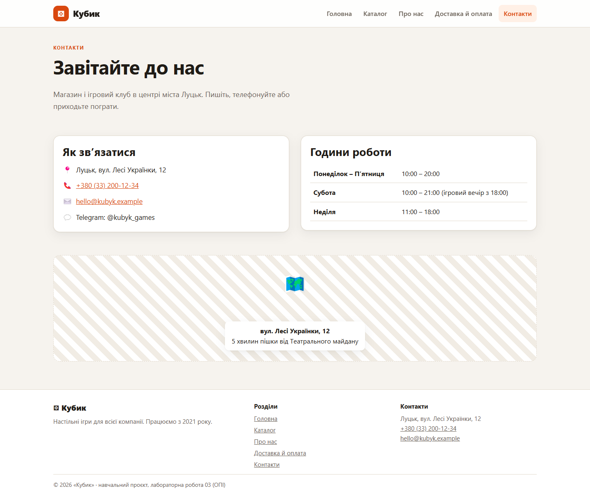 |
| 404 | 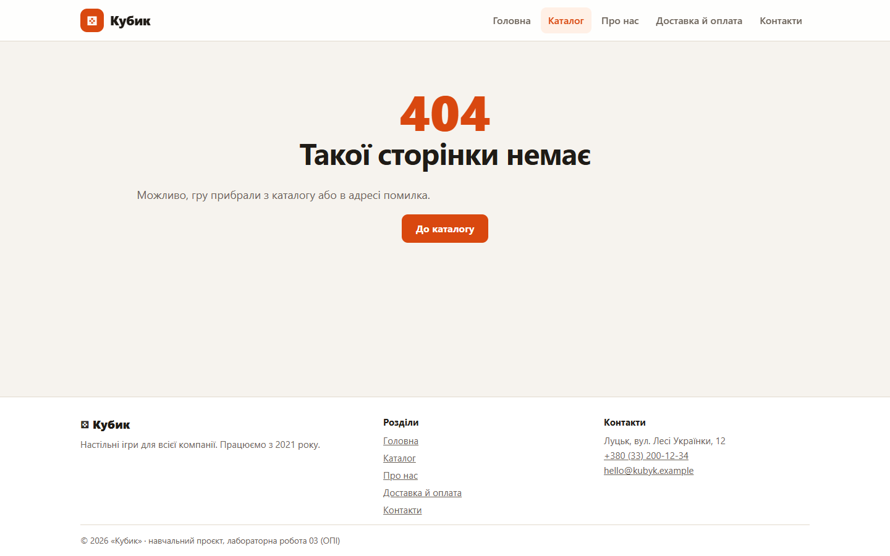 |

### Мобільний вигляд (390 px)

<p>
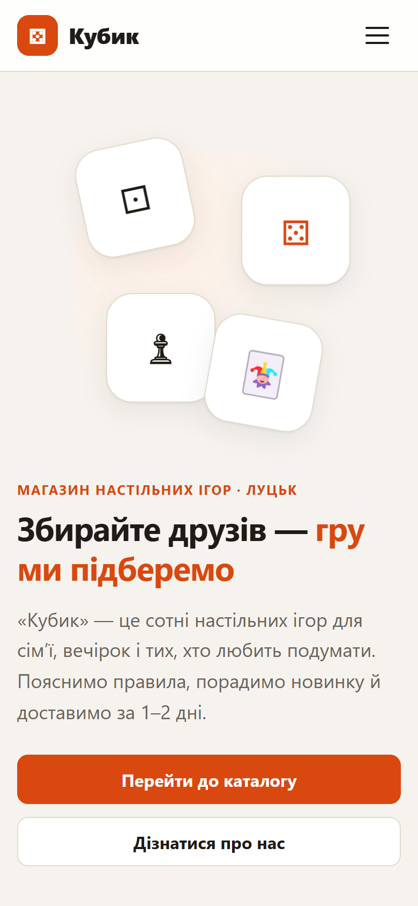
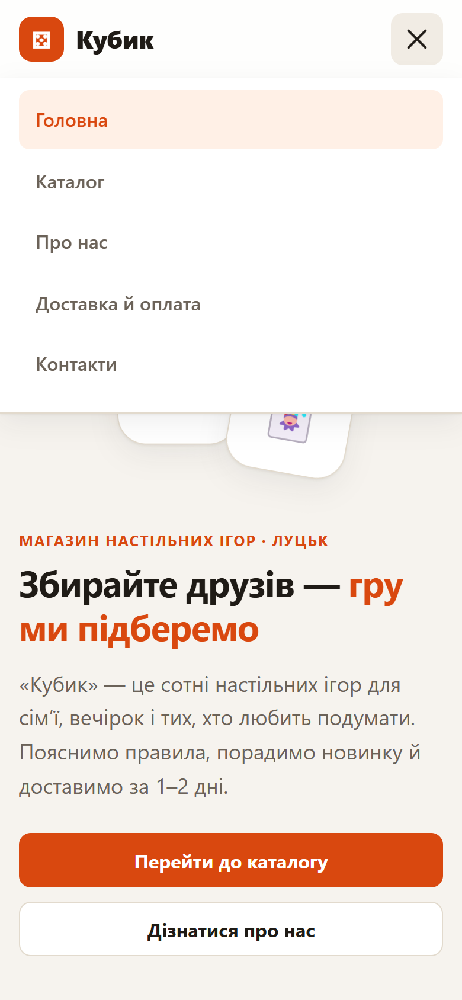
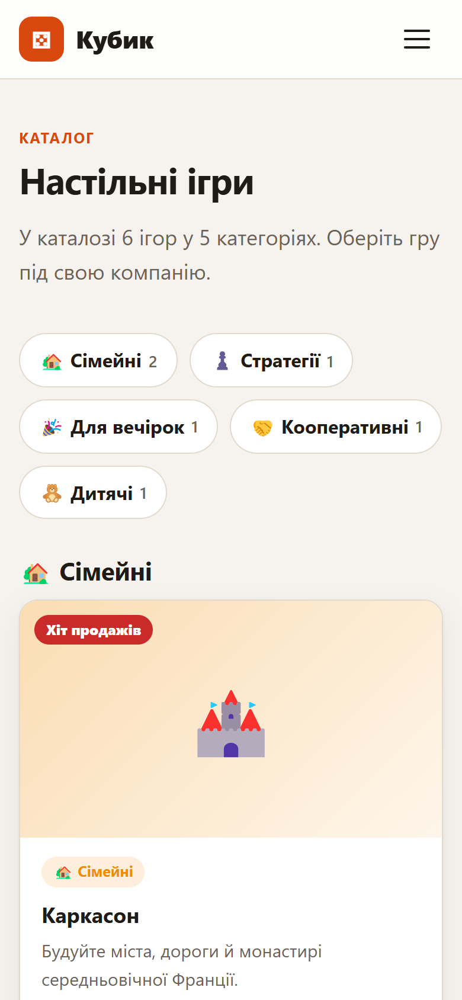
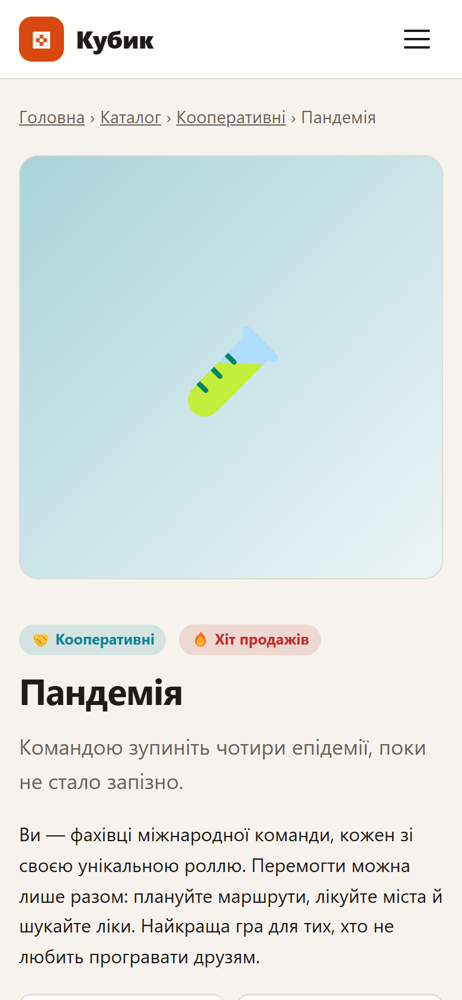
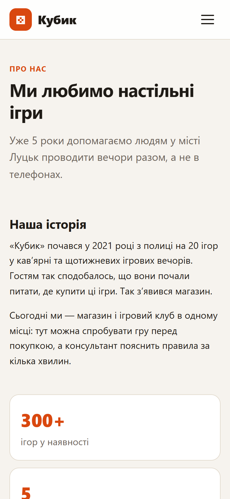
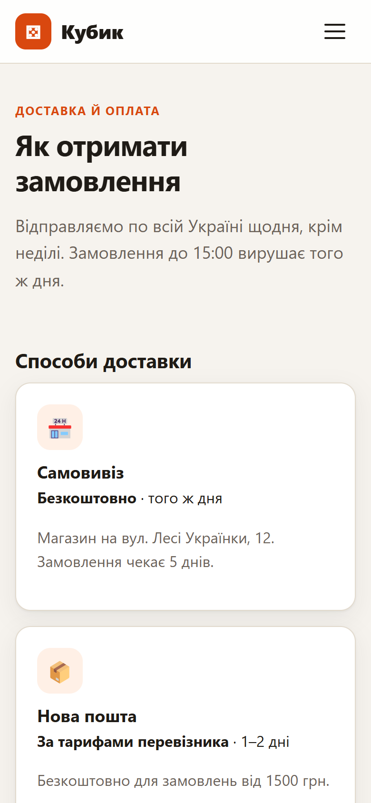
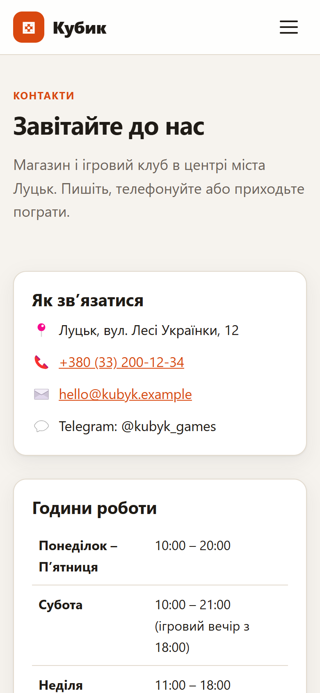
</p>

## 4. Тестування

```
python -m pytest
20 passed
```

Тести перевіряють, що кожна сторінка відкривається (код 200) і містить свій заголовок, що меню містить усі пункти й позначає поточний, що працює сторінка кожної гри, а неіснуючі адреси дають 404. Також перевіряються фільтр ціни та адаптивні мета-тег і медіазапити.

## 5. Труднощі та їх вирішення

| Проблема | Рішення |
|----------|---------|
| Макрос `game_card`, імпортований у сторінку, не бачив змінну `categories` з контекст-процесора (`UndefinedError`) | За замовчуванням імпортовані макроси не отримують контекст шаблону — додано `import ... with context` |
| Меню з п’яти пунктів не вміщується на телефоні | Мобільне меню-«бургер» на прихованому `checkbox` і селекторі `:checked ~ .main-nav` — працює без JavaScript |
| Бейдж категорії в картці розтягувався на всю ширину (батьківський елемент — flex-колонка) | `align-self: flex-start` для бейджа |
| Однакові картки ігор потрібні на трьох сторінках | Винесено в макрос `game_card`, щоб не дублювати розмітку |

## 6. Висновки

Створено багатосторінковий вебзастосунок на Flask: шість сторінок предметної області плюс сторінка 404. Усі сторінки наслідують один базовий шаблон, а меню й картки побудовані циклами та макросами Jinja2, тому розмітка не дублюється.
Адаптивність забезпечено власним CSS (Grid, Flexbox, медіазапити) і мобільним меню без JavaScript. Цей проєкт став основою для лабораторних 04–06, де дані перенесено в базу SQLite і додано REST API.

## 7. Відповіді на контрольні запитання

1. **Вебфреймворк** — набір готових інструментів для створення вебзастосунків: маршрутизація, обробка запитів, шаблони. Flask називають **мікрофреймворком**, бо в ядрі лише найнеобхідніше (маршрути, запити, шаблони Jinja2), а база даних, форми чи авторизація підключаються розширеннями за потреби.
2. **Маршрут** створюється декоратором `@app.route('/адреса')` над функцією. Декоратор реєструє функцію як обробник цієї адреси: Flask викликає її при запиті й повертає клієнту її результат.
3. **Параметр в адресі** задається в кутових дужках: `@app.route('/catalog/<slug>')`, і він передається у функцію як аргумент `def game(slug)`. Можна вказати тип: `<int:id>`.
4. **Jinja2** — шаблонізатор: він підставляє дані з Python у HTML (`{{ змінна }}`) і дає цикли, умови, фільтри та макроси. Завдяки цьому HTML не треба збирати рядками в коді, а логіка відокремлена від представлення.
5. **Наслідування**: `base.html` містить спільну розмітку (шапку, меню, футер) і «дірки» ``. Сторінка пише `` і заповнює лише свої блоки. Так меню й футер не дублюються, і змінювати їх треба в одному місці.
6. **`render_template('home.html', ...)`** знаходить шаблон, підставляє передані змінні й повертає готовий HTML. Шаблони Flask шукає в папці `templates/` поруч із застосунком.
7. **Віртуальне середовище** ізолює залежності проєкту від системних і від інших проєктів, тож версії бібліотек не конфліктують. **`requirements.txt`** фіксує точні версії, щоб будь-хто відтворив середовище командою `pip install -r requirements.txt`.
8. **Адаптивна верстка** — сторінка коректно виглядає на будь-якій ширині екрана. У Tailwind CSS для цього є префікси брейкпойнтів (`sm:`, `md:`, `lg:`), наприклад `grid-cols-1 md:grid-cols-3`. У цьому проєкті те саме зроблено власним CSS: медіазапитами `@media (max-width: ...)`, Grid з `auto-fill/minmax` і `clamp()` для шрифтів.
